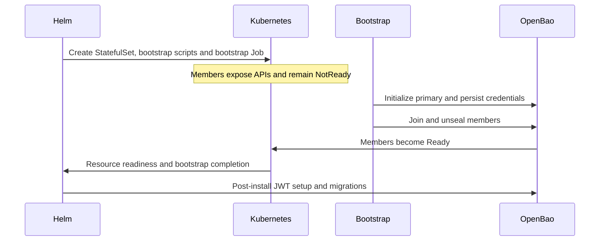

# NVCF OpenBao Helm Chart

This repository contains an opinionated Helm chart for deploying OpenBao in the
NVIDIA Cloud Functions (NVCF) self-hosted environment.

## Overview

The chart is designed to provide:

- An OpenBao server deployment built on top of the upstream
  `openbao/openbao-helm` chart
- A bootstrap Job that initializes and unseals members before readiness
- Post-install JWT configuration and post-install/post-upgrade migrations
- Opinionated defaults for HA, injector enablement, and operational hooks

## Readiness and bootstrap

The server readiness probe accepts active and standby members after unseal.
Sealed and uninitialized members stay NotReady. Client Services must set
`openbao.server.service.publishNotReadyAddresses=false` to exclude them from
routing. The self-managed HA values set this flag; standalone installs must
set it explicitly. Keep the internal headless Service publishing NotReady
addresses so Raft peers can discover one another during bootstrap.

With `--wait`, Helm waits for StatefulSet readiness before running post-install
hooks. The chart therefore creates a regular bootstrap Job with the StatefulSet. It
uses each member's local API while the member is NotReady, initializes the
primary, saves credentials and joins/unseals peers. The post-install Job then
waits for bootstrap completion and configures JWT support before migrations
run. It never initializes members, including installs without Helm `--wait`.



Bootstrap waits up to `openbao.hooks.initializeCluster.apiTimeoutSeconds`
(default 600 seconds) for member APIs. It reads the StatefulSet replica count
and selects the `openbao` container by name. A new Job name on each release
revision avoids immutable Job-template errors on upgrade. Existing initialized
members reuse saved credentials. Inconsistent state or missing credentials
fails closed instead of initializing again; restore the matching data and
credentials before retrying.

When upgrading with `--reuse-values`, explicitly replace the old readiness
path, which otherwise remains in the reused values:

```bash
helm upgrade openbao-server helm --namespace vault-system \
  --reuse-values \
  --set openbao.server.service.publishNotReadyAddresses=false \
  --set-string 'openbao.server.readinessProbe.path=/v1/sys/health?standbyok=true' \
  --wait --wait-for-jobs --timeout 20m
```

Retain your image, namespace and migration overrides when upgrading. With an
`OnDelete` StatefulSet strategy, the probe change reaches each Pod only after
that Pod is recreated. Roll one member at a time and verify recovery and Raft
quorum before continuing. After rollback to an older chart, that chart's
readiness defaults apply again.

## JWT plugin lifecycle

The bridge server image supplies declarative plugin registration at
`/openbao/plugin-config`; its entrypoint loads that directory on server startup.
Set `openbao.jwtPluginLifecycle.mode` for the deployment stage:

- `legacy` (default): retains the refresh hook for published pre-bridge images.
  Preflight rejects versioned images before changing the release.
- `bridge`: checks existing mount compatibility without rewriting the catalog.
  Defers migrations. Keep hooks enabled and rotate every member before enabling
  versioned mount creation. Upgrades only.
- `versioned`: checks image compatibility and pins new signing mounts to the
  target version from the server image. Use for fresh bridge installations
  and after an existing deployment completes its bridge migration.

The lifecycle driver can check and tune mounts independently of Helm hooks.
The migration Job rechecks catalog readiness after rollout because the active
member can change after preflight. Its init container also supplies the server
image's version manifest to migrations.

Publish and qualify the matching bridge server and migrations images before
advancing chart or stack image pins. Existing deployments need the staged
[JWT plugin upgrade procedure](../../../docs/self-managed/runbooks/openbao-jwt-plugin-upgrade.md),
including the explicit old version and a later cleanup release.

## Prerequisites

- Kubernetes cluster compatible with the bundled upstream OpenBao chart
- Helm 3
- `kubectl` configured for the target cluster
- Access to the required container images

## Images

This repository is published as chart source only.

This chart depends on NVIDIA-managed container images for the OpenBao server
extensions, migration jobs, and related operational tooling.

The default chart values do not set the required image registries and
repositories for those components. They must be supplied through an additional
values file at install time, and access to those images must be arranged
separately.

Example:

```yaml
openbao:
  migrations:
    image:
      registry: nvcr.io
      repository: <your-org>/nvcf-openbao-migrations
  server:
    image:
      registry: nvcr.io
      repository: <your-org>/nvcf-openbao
  injector:
    image:
      registry: nvcr.io
      repository: <your-org>/oss-vault-k8s
    agentImage:
      registry: nvcr.io
      repository: <your-org>/nvcf-openbao
```

The injector Deployment uses `openbao.injector.image` (`oss-vault-k8s`). The
Vault Agent sidecars it creates use `openbao.injector.agentImage`. The
self-managed stack selects `nvcf-openbao` for both the agent and server; the
auto-unseal sidecar also uses the server image. The chart checks that their
tags match. The shipped stack selects no third-party Vault Agent image.
Standalone installs supply the registries and repositories shown above.
Operators who select a separate agent image own its toolchain and CA bundle
verification.

## Installation

This chart is intended to be installed by invoking Helm directly from source.

1. Build dependencies:

```bash
helm dependency build helm
```

1. Install the chart:

```bash
helm install openbao-server helm \
  --namespace vault-system \
  --create-namespace \
  --values helm/values.yaml \
  --values path/to/values.yaml \
  --set openbao.server.service.publishNotReadyAddresses=false \
  --wait \
  --wait-for-jobs \
  --timeout 20m
```

## Configuration

Chart configuration lives in [helm/values.yaml](./helm/values.yaml). Additional
values files can be layered on top during installation.

Key configurable areas include:

- OpenBao server image settings and HA configuration
- Migration job image settings and migration environment variables
- Injector image settings
- Image pull secrets
- OIDC issuer discovery for migration-time JWT auth configuration

Important note on Helm list merging:

When overriding list values such as `extraContainers`, Helm replaces the
original list instead of merging it. Override the full list item to preserve
required fields from the base values file.

### Migration kubectl client

`openbao.migrations.kubectlMinor` controls both the initialization and migration
Jobs. Leave it empty to use the image default, or set `"1.36"` for Kubernetes
1.35 servers. The migrations 0.23.1 image provides kubectl 1.37.2 by default
and the patched 1.36.6 client through `NVCF_KUBECTL_MINOR="1.36"`. An explicit
`"1.37"` is also supported; other selections fail rendering.

Use an image that implements `NVCF_KUBECTL_MINOR` when setting this value.
Configure the selector here rather than also setting it in
`openbao.migrations.env`; specifying both fails rendering. Existing env-only
configuration still applies to the migration Job when `kubectlMinor` is empty.

## Uninstallation

```bash
helm uninstall openbao-server --namespace vault-system
```

## License

This project is licensed under the
[Apache License, Version 2.0](https://www.apache.org/licenses/LICENSE-2.0).
